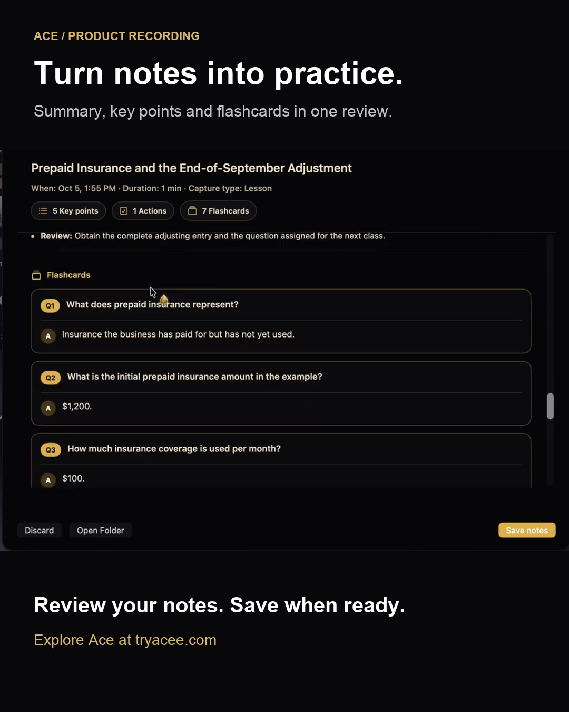

# Review a lesson in Ace

See the notes-review screen in this short, silent recording: a lesson summary, key points, and flashcards in one place.

[Play or download the 25-second recording](https://raw.githubusercontent.com/mthburnsbarber-web/ai-study-prompts/main/guides/media/ace-notes-review.mp4).

1. Read the summary and key points from your lesson.
2. Use the flashcards to quiz yourself on the material.
3. Choose **Save notes** when your review is ready to keep.

[Explore Ace](https://tryacee.com/?utm_source=github&utm_medium=guide&utm_campaign=notes-demo) · [Try a complete study exercise](first-session.md)
