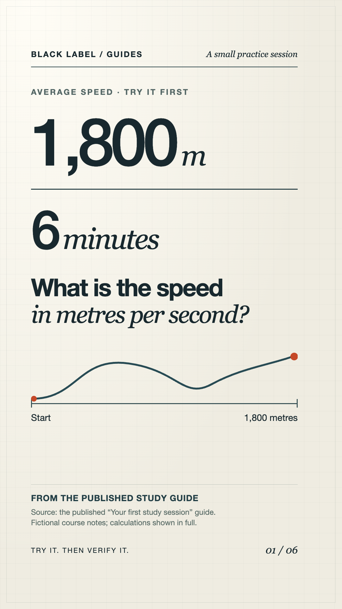

# Your first study session: answer, check, try again

You can use these study guides in an AI assistant you already have. Start with a small passage, answer a question yourself, and check the feedback against that passage.

This example uses fictional course notes. It needs no account with Black Label, installation, upload or personal information.

## 1. Copy this practice material

```text
Fictional course notes — average speed

Average speed = total distance / elapsed time.
Use the same units throughout a calculation.
1 kilometre = 1,000 metres. 1 minute = 60 seconds.
An average describes a whole journey; it does not tell you the speed at every moment.
```

## 2. Start the quiz

Paste this below the notes in your preferred assistant:

```text
Quiz me using only the notes above. Ask one question at a time and wait
for my attempt before giving feedback. Begin with a calculation, then
ask me to explain what the average can and cannot tell us.

If I get a calculation wrong, give one hint about units and let me try
again before showing the answer. Point to the specific sentence in my
notes that supports each explanation. Do not invent a citation.

After three questions, list the idea I should practise next. If the notes
do not support an answer, say what additional source is needed.
```

Write your attempt before reading the assistant's response. For a calculation, include your units and one line of working.

## 3. Check one answer yourself

Try this question: **A cyclist travels 1,800 metres in six minutes. What is the average speed in metres per second?**

<details>
<summary>Open the worked answer after your attempt</summary>

Six minutes is 6 × 60 = **360 seconds**. Average speed is 1,800 ÷ 360 = **5 metres per second**.

That result does not show whether the cyclist travelled at five metres per second throughout the journey. The final sentence of the notes explains this limitation.

If the assistant says 300 metres per second, it divided by minutes without converting them to seconds. Check the units rather than trusting a confident explanation.

</details>

Now change one detail: keep the distance the same, but use three minutes. Explain what should happen to the average before calculating it.

<details>
<summary>Check the changed example</summary>

The time is halved, so the average speed doubles. Three minutes is 180 seconds; 1,800 ÷ 180 = **10 metres per second**.

</details>

## Visual walkthrough

After you have tried the calculation, open the 27-second illustrated walkthrough. It shows the unit conversion and compares the two answers from this exercise. The video is silent; the explanation is on screen. It illustrates these course notes and is not a recording of the Ace application.

<details>
<summary>Show the walkthrough and download</summary>

[](media/check-the-units.mp4)

[Watch or download the MP4](media/check-the-units.mp4). If the repository preview does not play it, use the file's Download control.

</details>

## 4. Switch to your own subject

Open the [field guide index](../README.md#fields), then choose one short section of material you are allowed to use. Replace the fictional notes with that section and use the prompt from your field guide.

Keep a simple review note:

| Question | My first attempt | Source check | What I will retry |
| --- | --- | --- | --- |
| Average speed | My calculation and units | Formula and conversion in the notes | A new distance or time |

Use your course's approved source to resolve a disagreement. An assistant's feedback is a practice aid, not an answer key or an exam-provider endorsement. Keep patient, client and student information out of the material.

## Continue

- [General college study](../fields/college-students.md)
- [All fields and subject guides](../README.md#fields)
- [Use the optional study-coach skill](../README.md#use-it-as-an-agent-skill)
- [Explore Ace](https://tryacee.com/?utm_source=github&utm_medium=study-quickstart&utm_campaign=visibility) for the current product features and access options. This exercise also works in other assistants.

Original example by Black Label Tech. [CC BY 4.0](../LICENSE).
